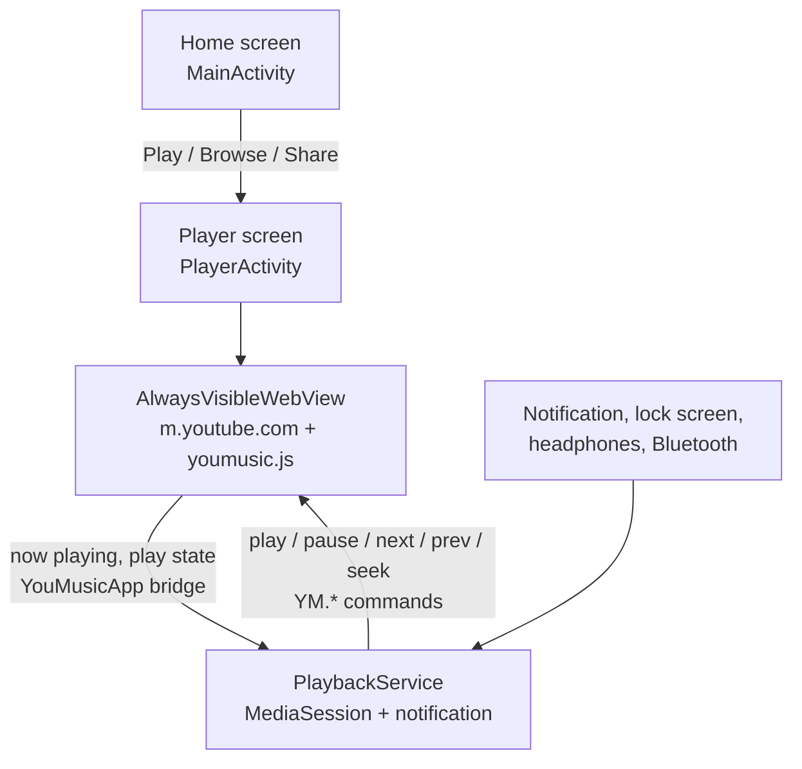

# YouMusic: developer guide

This page is for people who want to understand, build or change the code.
If you just want the app, see the [README](README.md).

[](https://github.com/billyke2000s/Youmusic/actions/workflows/build.yml)

---

## How background playback works

YouMusic doesn't download or decode YouTube streams. It shows the real YouTube
mobile website (`m.youtube.com`) inside an Android **WebView**, keeps that page
running when the app leaves the screen, and wires it to a proper Android media
session.



### What normally stops the music, and the fix for each

| Problem | Fix | Where |
|---|---|---|
| Android reports the app's window as hidden, so Chromium hides the page and the video pauses. **This was the cause of v1.0 stopping as soon as you left the app.** | A WebView subclass that always reports its window as `VISIBLE`. Fullscreen video gets the same treatment through a container view. | `AlwaysVisibleWebView.java` |
| Apps normally pause the WebView when hidden. | `WebView.onPause()` / `pauseTimers()` are never called. | `PlayerActivity.java` |
| Android lowers the page's renderer priority off-screen and may kill it. | `setRendererPriorityPolicy(RENDERER_PRIORITY_IMPORTANT, false)`. | `PlayerActivity.java` |
| YouTube's own script checks whether the page is visible. | The Page Visibility API is overridden to always say visible. | `assets/youmusic.js` |
| YouTube can still pause by itself (e.g. "Video paused. Continue watching?"). | A background guard: while the app is really in the background and the user didn't pause, it dismisses single-button prompts and resumes, up to 3 attempts. It never resumes during a phone call. | `assets/youmusic.js` |
| Android kills background apps. | `PlaybackService` is a `mediaPlayback` foreground service. It re-asserts foreground every 60 s while playing, because Android has been seen silently dropping it after a long time in the background. A partial wake lock is held only while playing. | `PlaybackService.java` |

### Media controls

`PlaybackService` owns an `android.media.session.MediaSession` (built-in API, no
AndroidX) and posts a `Notification.MediaStyle` notification linked to it:

- **Metadata:** title, channel, duration (for the seek bar) and artwork, read from
  YouTube's player (`getPlayerResponse().videoDetails`). Artwork is
  `i.ytimg.com/vi/<id>/hqdefault.jpg`, cropped to a square and scaled to 400 px so it
  stays under Android's notification size limits.
- **Buttons:** on Android 13+ the shade builds its buttons from the session's
  `PlaybackState` actions (previous, play/pause, next, seek, plus a custom Close
  action). On Android 12 and below it uses the notification's own actions.
- **Commands** go back into the page as `YM.play()`, `YM.pause()`, `YM.next()`,
  `YM.prev()` and `YM.seekTo(s)`, which call YouTube's player
  (`#movie_player.playVideo()`, `nextVideo()`, ...). Outside a playlist, Next falls
  back to clicking the mobile player's own Next button. Previous restarts the song
  if it's past 3 seconds, like music apps.
- **Headphones:** `ACTION_AUDIO_BECOMING_NOISY` (unplugged, Bluetooth dropped)
  pauses.

### App lifecycle

- **Home button, app switch, screen off:** keeps playing.
- **Back on the first page:** `moveTaskToBack()`, so it keeps playing.
- **Close (✕) in the notification:** pauses, stops the service and closes the player.
- **Swiped away from recents:** `onTaskRemoved()` stops everything. The WebView
  lives in the activity, so there's nothing left to play once the task is gone.

Navigation to `intent://` and `vnd.youtube://` URLs is blocked, so the site can't
bounce the user into the official YouTube app.

None of this is an official API. It may behave differently across Android versions
and phone makers, and YouTube website changes could break the player hooks in
`youmusic.js`.

### Credit

The always-visible WebView, background guard and foreground re-assert techniques
were learned by reading [NouTube](https://github.com/nonbili/NouTube) (AGPL-3.0),
an open-source YouTube client that uses the same WebView approach. YouMusic's code
is an independent implementation and doesn't copy NouTube's source.

---

## Project structure

```
Youmusic/
├── .github/
│   ├── workflows/build.yml          # Builds the APK and publishes a release
│   └── ISSUE_TEMPLATE/bug_report.md
├── app/
│   ├── build.gradle                 # Package name, SDK levels, version, signing
│   ├── debug.keystore               # Shared signing key (see "Signing" below)
│   └── src/main/
│       ├── AndroidManifest.xml      # Screens, service, permissions, Share entry
│       ├── assets/youmusic.js       # Injected into YouTube: controls, reporting, guard
│       ├── res/drawable/            # App icon + notification icon
│       └── java/com/youmusic/app/
│           ├── MainActivity.java         # Home screen: paste box, Play, Browse
│           ├── PlayerActivity.java       # Hosts the WebView, bridge, back/fullscreen
│           ├── AlwaysVisibleWebView.java # WebView that never reports itself hidden
│           ├── PlaybackService.java      # MediaSession, media notification, wake lock
│           └── YouTubeLinks.java         # Turns pasted text into a playable URL
├── build.gradle                     # Android Gradle Plugin version
├── settings.gradle
└── gradle.properties
```

| File | Responsible for |
|---|---|
| `MainActivity.java` | Builds the home screen in code (no XML layouts). Handles `ACTION_SEND` from the Share menu. Requests notification permission on Android 13+. |
| `YouTubeLinks.java` | Extracts a URL from pasted text, checks it's YouTube, and converts it to `https://m.youtube.com/watch?v=...`. Video and playlist IDs are validated against strict patterns. |
| `PlayerActivity.java` | WebView setup, injecting `youmusic.js`, the `YouMusicApp` JavaScript bridge, telling the page when the app is really in the background, back button, fullscreen, headphone-unplug pause. `singleTask`, so the notification reopens the same player. |
| `AlwaysVisibleWebView.java` | Overrides `onWindowVisibilityChanged` so Chromium never hides the page. Includes the fullscreen container. |
| `PlaybackService.java` | MediaSession, metadata and artwork, playback state, media notification and its buttons, foreground re-assert, wake lock, Close and swipe-away handling. |
| `assets/youmusic.js` | `window.YM` controls, now-playing reports, background guard. |

---

## Building

### On GitHub (no setup)

Every push builds the APK. Pushes to `main` also publish a release tagged
`v<baseVersion>.<run number>` (e.g. `v1.0.7`) with `YouMusic.apk` attached.
To build by hand: **Actions → Build YouMusic APK → Run workflow**.

### On your computer

Requirements: JDK 17, Android SDK platform 34, Gradle 8.9+.

```bash
git clone https://github.com/billyke2000s/Youmusic.git
cd Youmusic
gradle assembleDebug
```

Output: `app/build/outputs/apk/debug/app-debug.apk`. You can also open the folder in
Android Studio and press **Run**.

| | Version |
|---|---|
| Android Gradle Plugin | 8.5.2 |
| Gradle | 8.9 |
| compileSdk / targetSdk | 34 |
| minSdk | 24 (Android 7.0) |
| Java | 17, no external libraries |

---

## Versioning

- `baseVersion` in `app/build.gradle` is set by hand (currently `1.0`).
- The GitHub Actions run number is added automatically, so builds become `1.0.5`,
  `1.0.6`, and so on.
- `versionCode` is the run number. It must always go up, or Android won't update.
- Local builds get build number `1`.

---

## Signing

Every build is signed with `app/debug.keystore`, which is committed to the repo.
That way all releases share one signature, and Android lets each new version
install over the previous one.

**Trade-off:** because the key is public, anyone could sign their own APK with the
same package name, and it would install over a real YouMusic. Only download
YouMusic from this repo's Releases page. Before publishing more widely, the next
step is to:

1. generate a private release key,
2. store it as a GitHub Actions secret,
3. sign `assembleRelease` with it in the workflow,
4. delete `app/debug.keystore` from the repo.

Moving to a new key means users have to uninstall once before installing.

---

## Contributing

See [CONTRIBUTING.md](CONTRIBUTING.md). Changes are listed in
[CHANGELOG.md](CHANGELOG.md).
