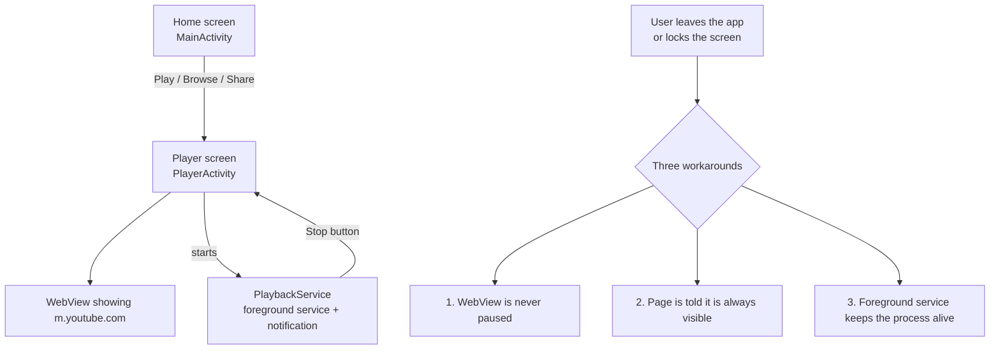

# YouMusic: developer guide

This page is for people who want to understand, build or change the code.
If you just want the app, see the [README](README.md).

[](https://github.com/billyke2000s/Youmusic/actions/workflows/build.yml)

---

## How background playback works

YouMusic doesn't download or decode YouTube streams. It shows the real YouTube
mobile website (`m.youtube.com`) inside an Android **WebView**, then stops Android
and YouTube from pausing it when you leave the app.



Normally three things stop audio when an app is backgrounded. YouMusic works
around each one:

1. **Android pauses the WebView.** Apps usually call `WebView.onPause()` and
   `pauseTimers()` when hidden. `PlayerActivity` deliberately does not. It also
   sets the renderer priority to `RENDERER_PRIORITY_IMPORTANT` (Android 8+).
2. **YouTube pauses itself when the page is hidden.** A JavaScript snippet
   (`KEEP_VISIBLE_JS` in `PlayerActivity.java`) is injected on every page load. It
   makes `document.hidden` always `false` and swallows `visibilitychange`,
   `pagehide`, `freeze` and `blur` events before YouTube's own listeners see them.
3. **Android kills background apps.** `PlaybackService` is a `mediaPlayback`
   foreground service with a notification. It holds a partial wake lock, capped at
   6 hours, so the CPU stays on with the screen off.

Navigation to `intent://` and `vnd.youtube://` URLs is blocked, so the site can't
bounce the user into the official YouTube app.

None of this is an official API. It may behave differently across Android versions
and phone makers, and a YouTube website change could break step 2.

---

## Project structure

```
Youmusic/
├── .github/
│   ├── workflows/build.yml          # Builds the APK and publishes a release
│   └── ISSUE_TEMPLATE/bug_report.md
├── app/
│   ├── build.gradle                 # Package name, SDK levels, version, signing
│   ├── debug.keystore               # Shared signing key (see "Signing" below)
│   └── src/main/
│       ├── AndroidManifest.xml      # Screens, service, permissions, Share entry
│       ├── res/drawable/ic_launcher.xml
│       └── java/com/youmusic/app/
│           ├── MainActivity.java    # Home screen: paste box, Play, Browse
│           ├── PlayerActivity.java  # WebView player + background-play workarounds
│           ├── PlaybackService.java # Foreground service, notification, wake lock
│           └── YouTubeLinks.java    # Turns pasted text into a playable URL
├── build.gradle                     # Android Gradle Plugin version
├── settings.gradle
└── gradle.properties
```

| File | Responsible for |
|---|---|
| `MainActivity.java` | Builds the home screen in code (no XML layouts). Handles `ACTION_SEND` from the Share menu. Requests notification permission on Android 13+. |
| `YouTubeLinks.java` | Extracts a URL from pasted text, checks it's YouTube, and converts it to `https://m.youtube.com/watch?v=...`. Video and playlist IDs are validated against strict patterns. |
| `PlayerActivity.java` | WebView setup, script injection, back button, fullscreen video, starting and stopping the service. `singleTask`, so the notification reopens the same player. |
| `PlaybackService.java` | Notification with a Stop action and the wake lock. Stop sends a package-scoped broadcast that makes `PlayerActivity` finish. |

---

## Building

### On GitHub (no setup)

Every push builds the APK. Pushes to `main` also publish a release tagged
`v<baseVersion>.<run number>` (e.g. `v1.0.7`) with `YouMusic.apk` attached.
To build by hand: **Actions → Build YouMusic APK → Run workflow**.

### On your computer

Requirements: JDK 17, Android SDK platform 34, Gradle 8.9+.

```bash
git clone https://github.com/billyke2000s/Youmusic.git
cd Youmusic
gradle assembleDebug
```

Output: `app/build/outputs/apk/debug/app-debug.apk`. You can also open the folder in
Android Studio and press **Run**.

| | Version |
|---|---|
| Android Gradle Plugin | 8.5.2 |
| Gradle | 8.9 |
| compileSdk / targetSdk | 34 |
| minSdk | 24 (Android 7.0) |
| Java | 17, no external libraries |

---

## Versioning

- `baseVersion` in `app/build.gradle` is set by hand (currently `1.0`).
- The GitHub Actions run number is added automatically, so builds become `1.0.5`,
  `1.0.6`, and so on.
- `versionCode` is the run number. It must always go up, or Android won't update.
- Local builds get build number `1`.

---

## Signing

Every build is signed with `app/debug.keystore`, which is committed to the repo.
That way all releases share one signature, and Android lets each new version
install over the previous one.

**Trade-off:** because the key is public, anyone could sign their own APK with the
same package name, and it would install over a real YouMusic. Only download
YouMusic from this repo's Releases page. Before publishing more widely, the next
step is to:

1. generate a private release key,
2. store it as a GitHub Actions secret,
3. sign `assembleRelease` with it in the workflow,
4. delete `app/debug.keystore` from the repo.

Moving to a new key means users have to uninstall once before installing.

---

## Contributing

See [CONTRIBUTING.md](CONTRIBUTING.md). Changes are listed in
[CHANGELOG.md](CHANGELOG.md).
