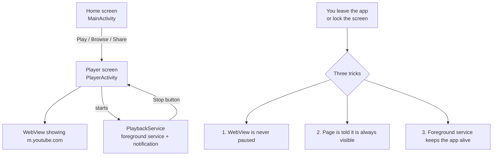

# YouMusic

[](https://github.com/billyke2000s/Youmusic/actions/workflows/build.yml)

A small Android app that plays YouTube the way Spotify plays music: you can
leave the app or lock your screen and the audio is meant to keep going.

Open the app and you get two choices:

- **A giant paste box.** Paste any YouTube link and hit Play.
- **Browse YouTube.** Opens the normal YouTube mobile home page inside the app.

> [!WARNING]
> **Background playback is experimental.** It is not an official YouTube feature
> for free accounts, it relies on workarounds (explained below), and it has not
> been tested on a wide range of phones. It may stop when the screen locks on some
> devices, or break when YouTube changes its website.

---

## Contents

- [Features](#features)
- [Install](#install)
- [How to use](#how-to-use)
- [Supported links](#supported-links)
- [How it works](#how-it-works)
- [Project structure](#project-structure)
- [Building it yourself](#building-it-yourself)
- [Permissions](#permissions)
- [Known limitations](#known-limitations)
- [Legal](#legal)
- [License](#license)

---

## Features

| Feature | Details |
|---|---|
| Paste a link | A full-width paste box on the home screen, plus a **Paste from clipboard** button |
| Browse YouTube | Loads `m.youtube.com` inside the app, so you can search, scroll and sign in |
| Background play | Attempts to keep audio playing when the app is minimised or the screen is off |
| Share to YouMusic | In the YouTube app (or a browser) tap **Share → YouMusic** to play it straight away |
| Notification | Shows a "Playing in the background" notification with a **Stop** button |
| Fullscreen video | Rotating / fullscreen video works inside the player |
| No extra libraries | Uses only the built-in Android framework, so the APK is tiny (about 16 KB) |

What it does **not** do: block ads, download videos, or save offline music.

---

## Install

### ⬇️ [Download YouMusic.apk](https://github.com/billyke2000s/Youmusic/releases/latest/download/YouMusic.apk)

1. Tap the link above, or go to the
   [Releases page](https://github.com/billyke2000s/Youmusic/releases/latest) and
   download **YouMusic.apk**.
2. Open `YouMusic.apk` on your phone. If Android asks, allow your browser or file
   manager to **install unknown apps**.
3. On Android 13 and newer, allow notifications when the app asks. The background
   notification is part of what keeps the app alive.

To update, download the latest APK and install it over the old one.

Requires **Android 7.0 (API 24) or newer**.

---

## How to use

**Play a link**
1. Copy a link from YouTube.
2. Open YouMusic, tap **Paste from clipboard** (or long-press the box and paste).
3. Tap **▶ Play**.
4. Press the home button or lock your phone. Audio should keep playing.

**Browse**
- Tap **Browse YouTube**, find something and play it as normal.

**Share from the YouTube app**
- On any video tap **Share**, then choose **YouMusic**.

**Stopping**
- Tap **Stop** on the notification, or
- open the player and press back until you leave it.

---

## Supported links

All of these are turned into a link the player can open:

| You paste | Example |
|---|---|
| Normal video link | `https://www.youtube.com/watch?v=dQw4w9WgXcQ` |
| Short link | `https://youtu.be/dQw4w9WgXcQ` |
| YouTube Music link | `https://music.youtube.com/watch?v=dQw4w9WgXcQ` |
| Shorts / live / embed | `https://youtube.com/shorts/dQw4w9WgXcQ` |
| Video inside a playlist | `https://www.youtube.com/watch?v=dQw4w9WgXcQ&list=PL...` |
| Playlist only | `https://www.youtube.com/playlist?list=PL...` |
| Just the video ID | `dQw4w9WgXcQ` |
| Shared text with a link inside | `Check this out https://youtu.be/dQw4w9WgXcQ` |
| Other YouTube pages | channels, search results, etc. open on the mobile site |

Anything that is not a YouTube link is rejected with a message.

---

## How it works

YouMusic does not download or decode YouTube streams itself. It shows the real
YouTube mobile website inside an Android **WebView** and stops Android and YouTube
from pausing it when you leave the app.



Normally three things stop audio when an app goes into the background. YouMusic
works around each one:

1. **Android pauses the WebView.** Apps usually call `WebView.onPause()` and
   `pauseTimers()` when they are hidden. `PlayerActivity` deliberately does not.
   It also sets the WebView renderer to *important* priority (Android 8+), so it is
   less likely to be throttled.
2. **YouTube pauses itself when the page is hidden.** The YouTube website listens
   for the browser's "page hidden" events. A small JavaScript snippet
   (`KEEP_VISIBLE_JS` in `PlayerActivity.java`) is injected on every page load. It
   makes `document.hidden` always `false` and swallows `visibilitychange`,
   `pagehide`, `freeze` and `blur` events before YouTube sees them.
3. **Android kills background apps.** `PlaybackService` runs as a *media playback
   foreground service*. This shows a notification and tells Android the app is
   actively playing media. It also holds a partial wake lock (capped at 6 hours)
   so the CPU stays on with the screen off.

Links to other apps (`intent://`, `vnd.youtube://`) are blocked so YouTube cannot
bounce you out into the official app.

---

## Project structure

```
Youmusic/
├── .github/workflows/build.yml      # GitHub Actions: builds the APK on every push
├── app/
│   ├── build.gradle                 # App settings: package name, SDK versions
│   └── src/main/
│       ├── AndroidManifest.xml      # Screens, service, permissions, Share menu entry
│       ├── res/drawable/ic_launcher.xml   # App icon (vector)
│       └── java/com/youmusic/app/
│           ├── MainActivity.java    # Home screen: paste box, Play, Browse
│           ├── PlayerActivity.java  # WebView player + background-play tricks
│           ├── PlaybackService.java # Foreground service, notification, wake lock
│           └── YouTubeLinks.java    # Turns pasted text into a playable YouTube URL
├── build.gradle                     # Android Gradle Plugin version
├── settings.gradle                  # Project name and repositories
├── gradle.properties                # Gradle settings
├── CHANGELOG.md
├── CONTRIBUTING.md
└── LICENSE
```

| File | What it is responsible for |
|---|---|
| `MainActivity.java` | Builds the home screen in code (no XML layouts). Handles **Share → YouMusic**. Asks for notification permission on Android 13+. |
| `YouTubeLinks.java` | Pulls the URL out of pasted text, checks it is YouTube, and turns it into `https://m.youtube.com/watch?v=...`. Video and playlist IDs are checked against strict patterns. |
| `PlayerActivity.java` | Creates and configures the WebView, injects the "always visible" script, handles back and fullscreen, starts and stops the service. |
| `PlaybackService.java` | Shows the notification with the Stop button and holds the wake lock. When Stop is tapped it broadcasts to `PlayerActivity`, which closes. |

---

## Building it yourself

### Option 1: GitHub Actions (no setup)

Every push to this repo builds the APK automatically. Pushes to `main` also publish a
new release (tagged `v<version>.<build number>`, e.g. `v1.0.4`) with `YouMusic.apk`
attached. You can also start a build by hand: **Actions → Build YouMusic APK → Run
workflow**.

### Option 2: On your own computer

You need:

- JDK 17
- Android SDK with platform **34** (Android Studio installs this)
- Gradle 8.9 or newer

```bash
git clone https://github.com/billyke2000s/Youmusic.git
cd Youmusic
gradle assembleDebug
```

The APK appears at `app/build/outputs/apk/debug/app-debug.apk`.

Or open the folder in **Android Studio** and press **Run**.

### Versions used

| Thing | Version |
|---|---|
| Android Gradle Plugin | 8.5.2 |
| Gradle | 8.9 |
| Compile / target SDK | 34 (Android 14) |
| Minimum SDK | 24 (Android 7.0) |
| Java | 17 |
| Language | Java, no external libraries |

---

## Permissions

| Permission | Why |
|---|---|
| `INTERNET` | To load YouTube |
| `FOREGROUND_SERVICE` | To run the background playback service |
| `FOREGROUND_SERVICE_MEDIA_PLAYBACK` | Required on Android 14+ for a media playback service |
| `POST_NOTIFICATIONS` | To show the playback notification (Android 13+) |
| `WAKE_LOCK` | To keep the CPU awake with the screen off |

The app has no analytics, no tracking and no servers of its own. The only website it
talks to is YouTube (and Google, if you sign in).

---

## Known limitations

- **Background play is not guaranteed.** It depends on your phone maker's battery
  settings, your Android version and YouTube's current website. If audio stops when
  the screen locks, try setting YouMusic's battery usage to **Unrestricted** in
  Android Settings.
- **No lock-screen media controls.** There is no play/pause/skip on the lock screen
  yet; the notification only has Stop.
- **Ads still play.** This app does not block ads.
- **Debug build.** The APK is signed with a debug key. It is fine to install on your
  own phone but cannot go on the Play Store as-is.
- **YouTube changes can break it.** Because it uses the real YouTube website, an
  update on YouTube's side could stop background play working at any time.

---

## Legal

YouMusic is an independent hobby project. It is **not affiliated with, endorsed by
or connected to YouTube or Google.** "YouTube" is a trademark of Google LLC.

Background playback is a YouTube Premium feature, and using workarounds like this
app may go against
[YouTube's Terms of Service](https://www.youtube.com/t/terms). You use it at your
own risk.

---

## License

[MIT](LICENSE)
